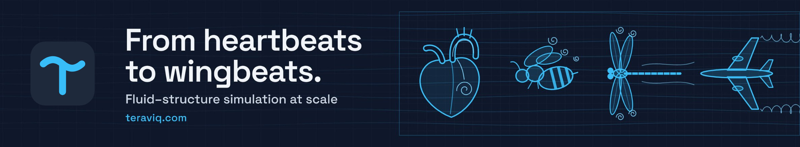

# Teraviq™

Teraviq is building a high-performance simulation platform for fluid–structure interaction: flows around moving, flexible and deforming bodies, from beating hearts and flapping insect wings to aircraft.

## Our vision

High-fidelity flow simulation is still slow, expensive and hard to set up. We believe it should be:

- **Fast**: designed from the ground up for modern GPUs and supercomputers
- **Adaptive**: resolution focused where the physics happens
- **Accessible**: from a laptop prototype to a full-scale production run
- **Intelligent**: smart numerical methods that put resolution where the physics happens.

## Status

Teraviq is in early development. Our core solver is being built and validated against established benchmark cases before public release.

## Follow along

- Website: [teraviq.com](https://teraviq.com)
- LinkedIn: [linkedin.com/company/teraviq](https://www.linkedin.com/company/teraviq)
- Bluesky: [@teraviq.com](https://bsky.app/profile/teraviq.com)
- Email: [hello@teraviq.com](mailto:hello@teraviq.com)
- Updates will be shared here, on LinkedIn and on Bluesky as the project matures.

---

© 2026 Teraviq. All rights reserved.
